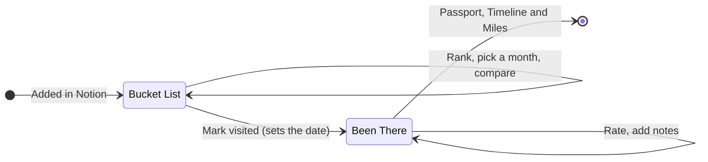
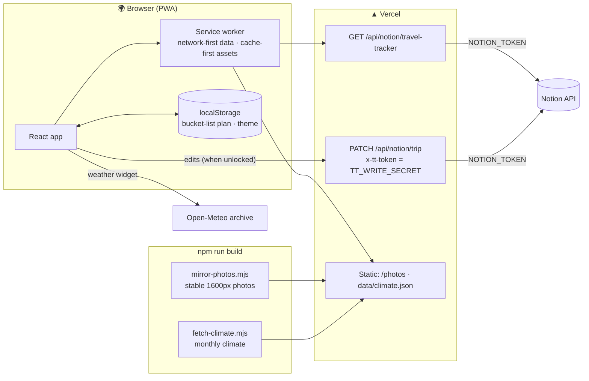
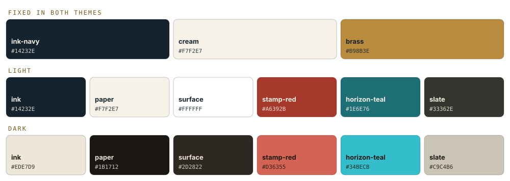

<p align="center">
  
</p>

<p align="center">
  
  
  
  
  
  
  
  
  
</p>

# Travel Tracker

Every trip you've taken, and every one you still want to, pulled live from a Notion database and laid out as a passport, a map and a timeline. Rate and annotate trips, stamp a Bucket List destination as visited, count the miles from home, and plan what's next. It installs as a PWA and keeps working offline.

<p align="center">
  
</p>

## At a glance

```mermaid
flowchart LR
    N[("🗂️ Notion<br/>Travel Tracker database")] -- "Destination · Country · Status<br/>Rating · Dates · Location · Photos" --> A["Vercel functions<br/>/api/notion/*"]
    A --> Q["useTrips()<br/>TanStack Query"]
    Q --> T1["🧳 Dashboard"]
    Q --> T2["🗺️ Map"]
    Q --> T3["🕰️ Timeline"]
    Q --> T4["🛂 Passport"]
    Q --> T5["✈️ Miles"]
    Q --> T6["📊 Insights"]
    Q --> T7["📝 Plan"]
    Q --> T8["⚖️ Compare"]
```



A trip's life, as the app sees it:



## About the data

The dashboard is built directly against the live schema of the Notion
**Travel Tracker** database (data source id
`1b1d8fd9-c723-4201-b1fc-5968d59e658a`), inspected via MCP on 2026-07-22.

### Schema map (as retrieved via MCP)

| Notion property | Type | Options / shape | Maps to |
|---|---|---|---|
| Destination | title | — | `Trip.destination` |
| Country | select | 20 options (USA, Greece, Italy, …) | `Trip.country` — dashboard filter, map grouping |
| Status | select | `Been There`, `Bucket List` | `Trip.status` — status filter, ink-stamp badge |
| Priority | select | `High`, `Medium`, `Low` | `Trip.priority` — card indicator dot |
| Rating | select | `★` … `★★★★★` | `Trip.ratingStars` (parsed to 1–5) |
| Trip Type | multi_select | Beach, City, Hiking, Food, Road Trip, Culture | `Trip.tripTypes` — filter pills, tags |
| Date Visited | date (range) | start / end / is_datetime | `Trip.dateVisited` — card date, year-grouped Timeline tab |
| Location | **place** | name / address / lat / lng | `Trip.location` — map markers, Miles Traveled route lines |
| Notes | rich text | — | `Trip.notes` |
| Photos | files | Notion-hosted or external | `Trip.photos` (gallery use in TripCard) |
| Passport Stamp | formula | opaque result (string/number/bool/date) | `Trip.passportStamp` |

**Schema gaps — read before wiring up Itinerary:**
The spec asked for an Itinerary module for "daily schedules linked to each
trip." That doesn't exist in the live database — there's no linked sub-item
relation for day-by-day plans. Rather than invent fields that aren't there:

- **`features/stats`** ships as `TripStats.tsx`: real aggregate metrics
  (trips taken, countries visited, bucket-list count, round-trip miles
  traveled) computed from data that actually exists.
- **`features/itinerary`** ships as `TripTimeline.tsx`: a chronological
  timeline of each trip's date range (with nights calculated). It's built
  to extend cleanly if you later add a linked "Itinerary Items" data source.

**Also worth knowing:** `Location` and `Passport Stamp` were excluded from
this data source's SQL query interface by Notion itself
(`notAvailableInQuerySql`) — they were read via direct page fetches instead.
`Passport Stamp`'s formula source isn't exposed by the Notion API at all
(only its computed result), so `transformNotionData.ts` reads it
defensively across all four possible result types instead of assuming one.

## Tabs

Eight tabs, each a real route (`react-router-dom`, paths in
`navigation/tabs.tsx`) so back/forward and shared links work. `?trip=<id>`
stays a search param, so it layers over whichever tab you're on. All read from
the same `useTrips()` / `useFilteredTrips()` data:

- **Dashboard** — filterable trip card grid (`TripDashboard.tsx`), the
  four-tile stat row (`TripStats.tsx`), plus compact Map and Timeline
  previews in the sidebar.
- **Map** (`MapPage.tsx`) — the full-size Leaflet map. Trips are grouped by
  rounded coordinates (`~111m`) so repeat visits to the same place collapse
  into one pin instead of overlapping markers; a grouped pin's popup lists
  every visit and opens that trip's detail modal on click.
- **Timeline** (`TimelinePage.tsx`) — every dated trip grouped by year, with
  photo thumbnails, trip-type tags, and rating, click-through to the same
  detail modal. Multiple visits to one place simply appear as separate
  entries in their own years.
- **Passport** (`features/passport/`) — every "Been There" trip as a stamp in
  a flip-through passport book (`PassportBook.tsx`). It prints as landscape
  sheets and can be shared as an image (see *Share the passport* below).
- **Miles Traveled** (`MilesPage.tsx`) — an infographic built around
  `HOME_LOCATION` (hardcoded to Fort Mill, SC in `notionAdapter.ts` — there's
  no home-base property in Notion): a hero total of round-trip miles to
  every "Been There" trip, farthest/closest callouts, a route map with
  dotted lines from home to each destination, a miles-by-year bar chart, a
  farthest-destinations leaderboard, and a continent/country coverage
  breakdown. Distances are straight-line (haversine, see `utils/geo.ts`),
  not actual road/flight miles.
- **Insights** (`InsightsPage.tsx`) — the aggregates `computeTripStats()`
  always returned but nothing rendered: trips by year, trip types, trips by
  country, the star-rating breakdown, and the countries you've put on the list
  but not reached. Charts come from `stats/charts.tsx`, shared with Miles
  Traveled so there's one bar-chart implementation.
- **Plan** (`features/planning/`) — the Bucket List as a working plan:
  drag-to-rank ordering, a "when" timeframe chip per trip, and a "Next
  adventure" picker that either picks at random or surfaces the closest
  unvisited destination. Plus two planners:
  - **Best time to go** (`SeasonsPlanner.tsx`) — pick a month, get your
    bucket list ranked by how good that month is there, scored with the same
    `scoreMonth()` the trip modal's weather chart uses (`utils/weather.ts`),
    against the precomputed `data/climate.json`.
  - **Trips you could combine** (`TripClusters.tsx`) — single-link clustering
    at a 150mi radius (`utils/clusterTrips.ts`), so five separate Utah/Arizona
    park entries read as one road trip. Deliberately *not*
    `groupTripsByLocation`, which rounds coordinates to ~111m for a different
    job entirely.

  **Ranking and timeframes live in `localStorage` only**
  (`useBucketListPlan.ts`) — Notion has no field for either, so they don't
  sync even though the app can now write.
- **Compare** (`features/compare/`) — search-and-add up to three trips and
  see them side by side (status, country, trip type, dates, rating,
  priority, distance from home, notes). Aimed at weighing Bucket List
  candidates against each other.

### Cross-cutting features

- **Filtering & sorting** (`useFilteredTrips.ts`, `filters/FilterBar.tsx`,
  `filters/FilterSheet.tsx`, `filters/SortMenu.tsx`) — Status/Region are single-select; Country and Trip type
  are **multi-select** (empty array means "All"). Sort by date, distance from
  home, rating, priority, or A–Z.
- **Editing** (`TripDetails/TripEditor.tsx`) — rate a trip, set its priority,
  write notes, and **Mark visited** (flips Bucket List → Been There with a
  date, which is what moves a trip into the Timeline and Passport). Writes go
  through `useUpdateTrip()`, which updates the cache optimistically and rolls
  back on failure. Renders only when the site is unlocked.
- **Trip detail modal** (`TripDetails/`) — adds a photo lightbox with
  keyboard/arrow navigation (`PhotoLightbox.tsx`), a "best time to visit"
  climate chart (`WeatherWidget.tsx`, backed by the free keyless Open-Meteo
  archive API — see `utils/weather.ts`), and a **Copy link** button. The
  modal syncs `?trip=<id>` into the URL, and `App.tsx` reads that param on
  load, so a copied link deep-links straight to that trip.
- **Dark mode** (`hooks/useTheme.ts`) — toggle in the header, respects
  `prefers-color-scheme` on first visit, persists to `localStorage`.
- **Print / PWA** — a print stylesheet in `index.css` strips nav and filter
  chrome (anything `.no-print`) and always prints the light palette; a
  manifest + service worker (`public/manifest.webmanifest`, `public/sw.js`)
  make the app installable and usable offline.
- **Share the passport** (`SharePassportButton.tsx`) — renders the passport to
  a PNG and hands it to the OS share sheet, falling back to a download. It
  rasterizes a purpose-built flat node (`SharePassportCard.tsx`), *not* the
  interactive book: each leaf carries `rotateY(180deg)` with
  `backface-visibility: hidden`, and html-to-image reproduces the transform
  but not the culling, so capturing the book comes out mirror-imaged.

## Architecture: deployment and data flow

Deployed on **Vercel**. A browser can't call the Notion API directly (it
requires a secret token and blocks browser CORS), so two serverless routes
hold the token server-side:

- `api/notion/travel-tracker.ts` — `GET`, proxies the data-source query.
  `services/notionAdapter.ts` reads from it on every load, so **trip data is
  live**; there is no build-time snapshot and no refresh cron.
- `api/notion/trip.ts` — `PATCH`, the only write path. Takes a domain-level
  patch (status, rating, priority, notes, date) and builds the Notion property
  JSON itself, so a caller can't reach a property this file doesn't name.
  Guarded by `TT_WRITE_SECRET`.

`vite.config.ts` mounts both handlers as middleware in `dev` **and**
`preview`, so `/api/notion/…` is the same URL everywhere.

Two build steps run before `vite build` (see `package.json`):

- `scripts/mirror-photos.mjs` — Notion's photo URLs are pre-signed S3 links
  that expire in an hour and differ on every query, so nothing can cache them.
  This copies each photo to a stable `/photos/<block-id>.<ext>`, resized to a
  1600px long edge (3.1MB → 0.6MB on the current set), and the GET route
  rewrites responses to point at them. The filename rule is shared with
  `src/utils/photoNaming.ts` and the two **must** agree.
- `scripts/fetch-climate.mjs` — precomputes monthly climate per location into
  `public/data/climate.json`, so the Seasons planner can score the whole
  bucket list without firing ~50 Open-Meteo requests on tab open.

Environment: `NOTION_TOKEN`, `TT_WRITE_SECRET`, `VITE_SITE_PASSWORD_HASH`.



## File hierarchy

```
travel-tracker/
├── api/
│   └── notion/
│       └── travel-tracker.ts        # example backend proxy (see note above)
├── public/
│   ├── manifest.webmanifest         # PWA manifest
│   ├── sw.js                        # service worker — see "Offline / PWA" below
│   └── icon-192.png / icon-512.png / icon.svg
├── src/
│   ├── types/
│   │   └── travel.ts                # domain types + raw Notion API types
│   ├── utils/
│   │   ├── transformNotionData.ts   # pure Notion JSON -> Trip parsers
│   │   ├── geo.ts                   # haversine distance
│   │   ├── regions.ts               # single source of truth: country -> continent
│   │   └── weather.ts               # Open-Meteo archive -> monthly climate averages
│   ├── services/
│   │   └── notionAdapter.ts         # fetch + TanStack Query hook + stats + HOME_LOCATION
│   ├── hooks/
│   │   └── useTheme.ts              # light/dark toggle + persistence
│   ├── lib/
│   │   └── queryClient.ts
│   ├── components/
│   │   └── PasswordGate.tsx         # client-side deterrent, not real auth — see file header
│   ├── features/
│   │   ├── trips/
│   │   │   ├── components/
│   │   │   │   ├── TripDashboard.tsx
│   │   │   │   ├── TripCard.tsx
│   │   │   │   ├── filters/FilterBar.tsx   # compact bar + active chips
│   │   │   │   ├── filters/FilterSheet.tsx  # modal sheet, live result count
│   │   │   │   ├── filters/SortMenu.tsx
│   │   │   │   ├── SearchBar.tsx
│   │   │   │   ├── PassportStamp.tsx      # shared signature element
│   │   │   │   └── TripDetails/
│   │   │   │       ├── TripDetailModal.tsx
│   │   │   │       ├── TripLocationMap.tsx
│   │   │   │       ├── TripPictures.tsx
│   │   │   │       ├── PhotoLightbox.tsx
│   │   │   │       └── WeatherWidget.tsx
│   │   │   ├── hooks/
│   │   │   │   ├── useFilteredTrips.ts     # filter + search + sort
│   │   │   │   └── useDestinationClimate.ts
│   │   │   └── utils/
│   │   │       ├── formatTrip.ts
│   │   │       └── stampRecipe.ts         # per-trip stamp shape/rotation/label
│   │   ├── map/
│   │   │   ├── components/
│   │   │   │   ├── TravelMap.tsx    # react-leaflet, no API key required
│   │   │   │   └── MapPage.tsx      # full-page Map tab
│   │   │   └── utils/
│   │   │       └── mapIcons.ts      # divIcon markers: status dot, visit-count badge, home
│   │   ├── stats/
│   │   │   └── components/
│   │   │       ├── TripStats.tsx    # dashboard stat row
│   │   │       └── MilesPage.tsx    # Miles Traveled tab + world coverage
│   │   ├── planning/               # Plan tab — localStorage-only, never syncs
│   │   │   ├── components/
│   │   │   │   ├── PlanPage.tsx
│   │   │   │   ├── BucketListPlanCard.tsx
│   │   │   │   └── NextAdventurePicker.tsx
│   │   │   └── hooks/
│   │   │       └── useBucketListPlan.ts
│   │   ├── compare/
│   │   │   └── components/
│   │   │       └── ComparePage.tsx
│   │   └── itinerary/
│   │       └── components/
│   │           ├── TripTimeline.tsx # dashboard sidebar preview — see "Schema gaps" above
│   │           └── TimelinePage.tsx # full-page Timeline tab
│   ├── App.tsx
│   ├── main.tsx
│   └── index.css                    # theme tokens, print + reduced-motion rules
├── tailwind.config.ts
├── vite.config.ts
├── tsconfig.json
└── package.json
```

## Offline / PWA

`public/sw.js` is hand-rolled (no build plugin) and deliberately **not**
cache-first across the board: trip data is live from Notion and editable
in-app, so a naive cache would serve a rating you changed a minute ago. It uses
network-first for navigations and the trip API (fresh wins, cache is the
offline fallback) and cache-first for Vite's content-hashed `/assets/` files
and the mirrored `/photos/`, whose bytes never change for a given URL.

Install-time it precaches the app shell, one trip-API response,
`data/climate.json`, and every photo listed in `photos/manifest.json` — so a
first-ever offline load has trips, weather and images.

Two non-obvious details, both learned by actually testing offline:

- **Install-time precache reads `index.html`.** On a first visit the page's
  JS/CSS are requested before the worker takes control, so they'd never be
  cached and a later offline load would boot blank. Since Vite hashes those
  filenames, the worker parses them out of the cached `index.html` and
  precaches them explicitly.
- **All cache lookups pass `ignoreVary: true`.** Static hosts send
  `Vary: Origin` on assets, and a `<script type="module" crossorigin>`
  request carries an `Origin` header the precache request didn't — strict
  Vary matching misses every precached asset and silently breaks offline.

Bump `VERSION` in `sw.js` when changing caching behavior; old caches are
dropped on activate.

## Design notes

<p align="center">
  
</p>

Palette and type are drawn from the subject itself — the database already
has a `Passport Stamp` formula and a "🛂 Passport" gallery view — so the UI
leans into a passport/ticket-stub identity rather than a generic travel-blue
theme: ink-navy + brass foil + a stamp-red/horizon-teal status pair, Fraunces
for display type, Inter for body copy, IBM Plex Mono for dates/data (see
`tailwind.config.ts`). The recurring rotated stamp badge (`PassportStamp.tsx`,
shape/rotation/tick-count/label derived per-trip in `stampRecipe.ts`) is the
one signature element, reused in trip cards, the detail modal, and the
Timeline tab rather than scattered across the UI.

The Miles Traveled charts (bar chart, ranked leaderboard) stick to the app's
existing palette rather than introducing new chart colors: brass as the
single sequential hue for every bar, with every value direct-labeled in
ink so the (sub-3:1) brass-on-paper contrast never has to carry a value
on its own.

### Theming (light / dark)

Colors split into two groups in `tailwind.config.ts`:

- **Fixed in both themes:** `ink-navy`, `cream`, `brass`. Together
  ink-navy + cream are the "always dark chrome and its light foreground"
  pair — the header, active tabs, and active filter pills look identical in
  either theme, which keeps the passport-stamp identity stable.
- **Theme-aware:** `ink`, `paper`, `surface`, `slate`, `stamp-red`,
  `horizon-teal`. Each resolves to an `rgb(var(--color-…) / <alpha-value>)`
  custom property defined under `:root` and `:root.dark` in `index.css`, so
  the whole palette swaps without touching component classNames.

`surface` is the card/panel color (it replaced hardcoded `bg-white/NN`): a
step lighter than `paper` in each mode, so `ink` text always has something to
stand against. The dark steps for `stamp-red` and `horizon-teal` are
lightened versions of the light-mode hues chosen to clear 4.5:1 against the
dark surface — not the same values dimmed. One gotcha worth knowing: the
passport stamp uses `mix-blend-mode: multiply` to sink ink into paper, which
on a dark surface darkens it into invisibility — it switches to `screen` in
dark mode for the equivalent effect.

## Running it

```bash
npm install
npm run dev            # http://localhost:5173
npm run build          # tsc -b, mirror photos, fetch climate, then vite build
npm test               # vitest over the pure utils
npm run lint           # eslint
npm run audit:mobile   # Playwright WebKit checks against the build
```

`npm run audit:mobile` boots `vite preview` and runs five checks (overflow,
touch targets, focus, contrast, glass) at iPhone widths in real WebKit. It
seeds an unlocked session (`scripts/mobile-audit/unlock.mjs`) so the in-modal
editing controls are covered too. Keep it green.

`vite.config.ts` serves `api/notion/*` in both `dev` and `preview`, so a
`NOTION_TOKEN` in `.env` is all you need for real data locally.

`PasswordGate` (wraps the whole app in `main.tsx`) only activates if
`VITE_SITE_PASSWORD_HASH` is set — leave it unset for local dev. For **reads**
it stays a deterrent rather than access control. For **writes** it is
load-bearing: on unlock the password is kept and sent as `x-tt-token`, and
`api/notion/trip.ts` rejects anything that doesn't match `TT_WRITE_SECRET`.
Keep the two in sync (the hash gates the UI, the plaintext gates the API), and
note that anyone who can unlock the site can edit it — there are no per-user
identities.

The service worker registers **in production builds only** — in dev it would
shadow Vite's HMR and the Notion proxy. To exercise offline behavior locally:

```bash
npm run build && npx vite preview   # http://localhost:4173
```

## License

[MIT](LICENSE) © 2026 Joey Thompson
